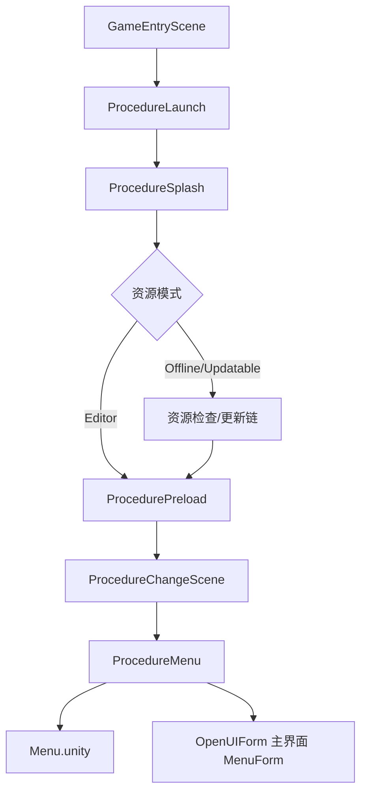
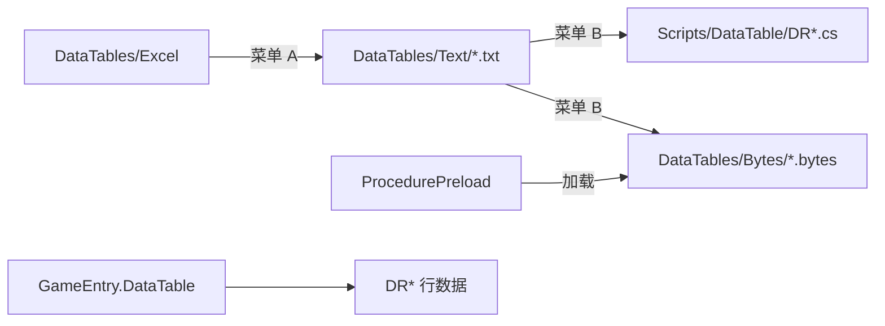

# 架构说明

## 1. 总体分层

```
┌─────────────────────────────────────────────────────────┐
│  MainGame（业务层）                                       │
│  Procedure / UI / Entity / Control / Platform / Network │
├─────────────────────────────────────────────────────────┤
│  UnityGameFramework.Runtime（框架封装层）                 │
│  GameEntry 组件、ProcedureComponent、UIComponent 等      │
├─────────────────────────────────────────────────────────┤
│  GameFramework（核心库，DLL）                             │
│  FSM、Resource、Event、Network、ObjectPool 等            │
└─────────────────────────────────────────────────────────┘
```

- **业务只改 MainGame**；框架层随 UGF 版本升级，不做业务定制。
- **GameEntry** 使用 `partial class` 拆分：`GameEntry.cs`（Start）、`GameEntry.Builtin.cs`（UGF 组件）、`GameEntry.Custom.cs`（项目组件）。

## 2. 启动与流程



### 流程类继承关系

```
GameFramework.Procedure.ProcedureBase
  └── ProcedureBase（InitProcedure/ProcedureBase.cs）
        ├── ProcedureLaunch / Splash / Preload / ChangeScene ...（InitProcedure）
        └── ProcedureFlowBase（CustomProcedure/ProcedureFlowBase.cs）
              └── ProcedureMenu / 玩法流程 ...
```

### 切场景 + 切流程（唯一入口）

玩法流程继承 `ProcedureFlowBase`，调用：

- `StartGame(ProcedureEnum, SceneEnum)` — 从 DRScene 表解析场景名
- `StartGame(ProcedureEnum, string sceneName)` — 直接指定 AssetName
- `BackToMenu()` — 回到菜单

内部写入 FSM 数据后 `ChangeState<ProcedureChangeScene>`。`ProcedureChangeScene` 卸载已加载场景，再 `GameEntry.Scene.LoadScene(AssetUtility.GetSceneAsset(...))`，完成后 `ChangeToTargetProcedure`。

**禁止**在业务代码中使用 `UnityEngine.SceneManagement.SceneManager.LoadScene`。

## 3. 模块职责

| 目录 | 职责 | 关键类型 |
|------|------|----------|
| `Base/` | 入口 | `GameEntry` |
| `Procedure/` | 生命周期流程 | `ProcedureFlowBase`, `ProcedureMenu` |
| `UI/` | 界面逻辑 | `UGuiForm`, `UIExtension` |
| `Entity/` | 实体逻辑 | `Entity`, `EntityData`, `EntityExtension` |
| `DataTable/` | 配置行（生成） | `DRScene`, `DRUIForm`, `DREntity` |
| `Definition/` | 常量与结构体 | `Constant.*`, `VersionInfo` |
| `Control/` | 输入 | `ControlComponent`, `GameControls`（生成） |
| `Platform/` | 多平台 | `PlatformComponent`, `IPlatformService` |
| `Network/` | 网络协议 | `NetworkChannelHelper`, `*Packet*`, `*Handler` |
| `ProgressObserver/` | 进度/任务观察 | `ProgressObserverComponent` |
| `Utility/` | 工具（分子目录） | `AssetUtility`、`CommonUtility`；详见 `Utility/README.md` |
| `Editor/` | 编辑器工具 | `DataTableGenerator`, 各类 Window |

## 4. 配置表数据流



预加载表名列表：`ProcedurePreload.DataTableNames`（Scene, Entity, Music, Sound, UIForm, UISound, UITranslation）。

运行时通过 `GameEntry.DataTable.GetDataRow<DRXxx>(id)` 访问；部分表同时生成 `XxxEnum`（如 `UIFormEnum`、`SceneEnum`）。`ProcedureEnum` 为手写，位于 `ProcedureBase.cs`。

## 5. UI 架构

- 配置：`DRUIForm`（Id, Name, AssetName, UIGroupName, AllowMultiInstance, PauseCoveredUIForm）
- Prefab：`Assets/MainGame/UI/UIForms/{AssetName}.prefab`
- 逻辑脚本：继承 `UGuiForm`（`UIFormLogic`），与 Prefab / AssetName 同名
- 打开：`GameEntry.UI.OpenUIForm(UIFormEnum.Xxx, userData)`
- 关闭：`uiForm.Close()` 或 `GameEntry.UI.CloseUIForm`
- 打包/热更：用 `Game Framework/Resource Tools/Resource Editor` 将 Prefab 分配到资源组（如 `ui`）后 Save；**禁止手改** `Configs/ResourceCollection.xml`

UI 组（Default / Popup / Game 等）在场景 `GameFramework` 对象上配置。

### 当前界面清单

| UIFormEnum | AssetName | 说明 |
|------------|-----------|------|
| `主界面` (100) | `MenuForm` | 菜单流程默认打开；离开流程时关闭 |
| （未入表） | `SettingForm` / `DialogForm` | 脚本与 Prefab 已存在；需写入 `UIForm.txt` 并生成后才能经表打开；`OpenDialog` 暂为 stub |

`UpdateResourceForm` 由资源更新流程直接挂载，不走 `UIForm` 表。

## 6. 实体架构

- 配置：`DREntity`（Id, AssetName）
- Prefab：`Assets/MainGame/Entities/{AssetName}.prefab`
- 逻辑：继承 `Entity`（`EntityLogic`），配合 `EntityData` 子类
- 实体组：`Constant.EntityGroup`（Default, Effect, WorldUI, System）
- 世界 UI：`DRWorldUI` + `EntityExtension.ShowWorldUI`，挂 `WorldUI` 组；组根由 `WorldUIGroupCanvas` 挂 World Space Canvas；摄像机优先 `WorldUIGroupCanvas.SetWorldCamera`，未绑定时回退 `Camera.main`
- ProgressObserver 实体：走 `EntityExtension.ShowProgressObserverEntity`，使用空实体 Prefab

## 7. 输入架构

配置：`Assets/MainGame/Configs/GameControls.inputactions`（路径见 `AssetUtility.GetInputActionsAsset`）。改完须 Generate C# Class。

```
Configs/GameControls.inputactions
  → Generate → GameControls.cs
  → ControlComponent（bindingMask 设备开关、总开关、UI 吞手柄）
  → 玩法只读 GameEntry.Control：GetAction* / GetMoveVector / GetLookVector
```

- 动作引用：`GameEntry.Control.Controls.Gameplay.*`
- 菜单/过场可 `BlockAllGameControl`；进入可操作玩法再 `EnableAllGameControl`
- 详情：`Scripts/Control/README.md`

## 8. 平台架构

`PlatformComponent` 按编译平台选择 `IPlatformService` 实现（Default / WeChat / DouYin 等），处理资源路径解析、特性开关等。新增平台时实现 `PlatformServiceBase` 并在 `PlatformComponent` 中注册。

## 9. 网络架构

- 序列化：ProtoBuf
- 客户端发包：`CSPacketBase` 子类，Id 唯一
- 服务端收包：`SCPacketBase` 子类 + `PacketHandlerBase` 子类（Id 与 Packet 一致）
- `NetworkChannelHelper.Initialize` 反射注册所有非抽象子类

## 10. ProgressObserver

流程进入/离开时调用 `GameEntry.ProgressObserver.OnProcedureEnter/Leave`；带 `[ProgressObserver]` 的 `ProgressObserverEntity` 子类按 SpawnMode 创建，完成态持久化在 Setting 中。

## 11. 资源路径约定

所有路径通过 `AssetUtility` 生成，例如：

| 类型 | 方法 | 路径模式 |
|------|------|----------|
| 场景 | `GetSceneAsset` | `Assets/MainGame/Scenes/{name}.unity` |
| UI | `GetUIFormAsset` | `Assets/MainGame/UI/UIForms/{name}.prefab` |
| 实体 | `GetEntityAsset` | `Assets/MainGame/Entities/{name}.prefab` |
| 配置表（运行时） | `GetByteDataTableAsset` | `Assets/MainGame/DataTables/Bytes/{name}.bytes` |
| 配置表（文本源） | `GetDataTableAsset(..., false)` | `Assets/MainGame/DataTables/Text/{name}.txt` |
| 音乐 | `GetMusicAsset` | `Assets/MainGame/Music/{name}.mp3` |
| 音效 | `GetSoundAsset` | `Assets/MainGame/Sounds/{name}.wav` |

`ProcedurePreload` 通过 `GetByteDataTableAsset` 加载二进制表。

## 12. 场景清单

| 场景 | DRScene / SceneEnum | 用途 |
|------|---------------------|------|
| GameEntryScene | 入口场景 | 挂载 GameFramework，启动 Procedure |
| Menu | 菜单场景 | 启动完成后默认场景；`ProcedureMenu` 打开 `MenuForm` |

Build Settings 需包含上述场景。
