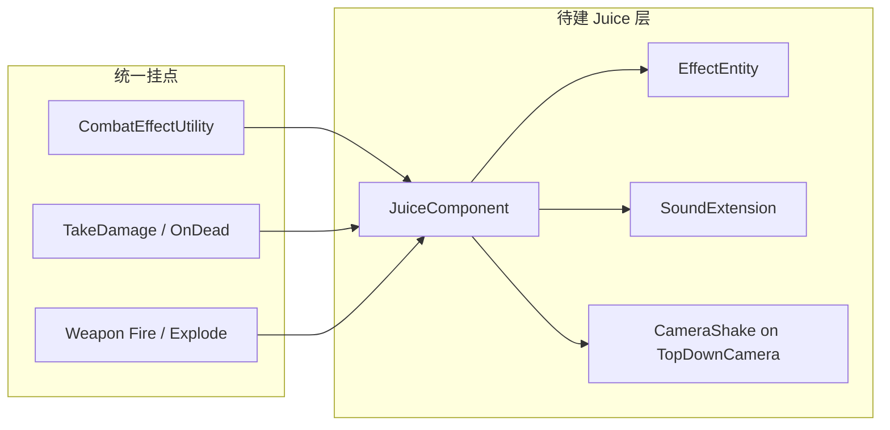

# Shard-Shot 手感细化计划（3 天 Demo）

> 核心玩法逻辑完成后，按本计划推进视听反馈、刷怪节奏与 HUD 抛光。  
> 总体设计见 [GAME_PLAN.md](GAME_PLAN.md)；架构约束见 [ARCHITECTURE.md](ARCHITECTURE.md)。

**目标周期**：约 3 天 Demo，优先视听冲击。  
**相机方案**：轻量 Perlin 震屏（扩展现有 `TopDownFollowCameraEntity`），不引入 Cinemachine。

---

## 任务进度

| ID | 阶段 | 内容 | 状态 |
|----|------|------|------|
| juice-component | Day 1 | 创建 `JuiceComponent` 并注册到 `GameEntry.Custom`，在战斗挂点接入 | 待办 |
| camera-shake | Day 1 | `TopDownFollowCameraEntity` 增加 Perlin 震屏 `AddImpulse` | 待办 |
| effect-entity | Day 1 | `Entity.txt` 新增特效行 + `EffectEntity` + `ShowEffect` + 粒子 Prefab | 待办 |
| audio-batch | Day 1 | 导入占位音频、扩展 `Sound.txt`、`JuiceComponent` 内 `PlaySound`、恢复 BGM | 待办 |
| weapon-juice | Day 2 | 三武器差异化反馈 + 敌人闪白 + 玩家受击 | 待办 |
| battle-hud | Day 2 | `BattleHudForm` 最小版（血条 / 弹药 / 热条） | 待办 |
| spawn-manager | Day 3 | 从 `ProcedureGame` 抽出 `SpawnManager` + 波次配置 + 刷怪校验 | 待办 |
| polish-record | Day 3 | `JuiceSettings.asset` 调参 + 录屏自测 | 待办 |

---

## 现状快照

| 模块 | 已有 | 缺口 |
|------|------|------|
| 战斗 | `CombatEffectUtility`、击退 / 眩晕 / 布偶死亡 | 无命中 VFX、闪白、震屏、HitStop |
| 音频 | `SoundExtension` + 三表 + 设置界面 | 无音频资源、无战斗 / UI 播放调用 |
| 相机 | `TopDownFollowCameraEntity` 平滑跟随 | 无震动、FOV 变化 |
| 刷怪 | `ProcedureGame` 定时环刷（max 15） | 无波次、无难度曲线 |
| 反馈 UI | 飘字 + 血条 | 无 BattleHud、无受击红边 |

核心优势：**伤害入口已统一**（`CombatEffectUtility.TryApplyHit` → `TakeDamage`），后续 Juice 只需在少数挂点叠加，不必重构战斗架构。



---

## 推荐工作方式

**原则：先打通一条「开火 → 命中 → 击杀」完整反馈链，再横向铺开。**

每天结束时用文末 Checklist 录屏自测；手感不对就调参数，不急着加新系统。

---

## Day 1 — 反馈中枢 + 最小视听（冲击最大）

### 1.1 建 `JuiceComponent`（`GameEntry.Custom.cs` 注册）

新建 `Assets/MainGame/Scripts/Juice/JuiceComponent.cs`，作为全局调度器，避免在武器 / 子弹里散落特效代码。

```csharp
// 对外 API 示意（参数用 ScriptableObject 或常量类）
void OnWeaponFire(WeaponType type, Vector3 position);
void OnHit(Vector3 position, HitContext ctx);      // 轻震 + 火花 + 命中音
void OnExplosion(Vector3 position, float radius);   // 重震 + HitStop + 爆炸特效
void OnKill(Vector3 position);                      // 击杀音 + 短震
```

**挂点（最小 diff）：**

| 位置 | 触发 |
|------|------|
| `CombatEffectUtility.TryApplyHit` 返回 true 后 | `OnHit` |
| `GrenadeBulletEntity.Explode()` | `OnExplosion` |
| `CharacterRangedAttackComponent` / 近战 `OnDamageApply` | `OnWeaponFire` |
| `DamageableCharacterEntity.OnDead` | `OnKill` |

### 1.2 相机震动（轻量 Perlin）

在 `TopDownFollowCameraEntity` 增加：

- `AddImpulse(amplitude, duration, frequency)` 队列
- `LateUpdate` 中对 `transform.localPosition` 叠加衰减 Perlin 偏移
- 预设：`FireLight(0.05, 0.1s)` / `HitMedium(0.12, 0.15s)` / `ExplosionHeavy(0.35, 0.3s)`

与现有 ragdoll 跟随逻辑兼容，不安装 Cinemachine。

### 1.3 特效实体（短命 VFX）

按 `Constant.EntityGroup.Effect` 规划：

1. `DataTables/Text/Entity.txt` 新增：`HitSpark`、`MuzzleFlash`、`ExplosionFx`
2. 执行 `DataTables/B` 生成 → `EntityEnum`
3. `EntityExtension.ShowEffect(effectEnum, position, rotation)` + `EffectEntity`（`ParticleSystem` 播完或定时 `HideEntity`）
4. Prefab 放 `Assets/MainGame/Entities/Effects/`（URP 简单粒子即可，占位也行）

### 1.4 音频首批（10～15 条）

1. 找 / 录占位 wav → `Sounds/`、`UI/UISounds/`
2. 扩展 `DataTables/Text/Sound.txt`：`gatling_fire_1`、`hit_metal`、`explosion`、`enemy_death` 等
3. 在 `JuiceComponent` 内调用 `GameEntry.Sound.PlaySound(SoundEnum.X, bindingEntity)`
4. 恢复 `ProcedureChangeScene` 中注释掉的 `PlayMusic`
5. `CommonButton` / 武器切换处补 `PlayUISound(click/select)`

**Day 1 交付标准：** 加特林开火有火光 + 音效 + 微震；子弹命中有火花 + 音 + 中震；手雷爆炸有粒子 + 重震 + 爆炸音。

---

## Day 2 — 武器差异化 Juice + 受击反馈

### 2.1 按武器调参（对照 [GAME_PLAN.md §8](GAME_PLAN.md)）

| 武器 | 重点 |
|------|------|
| 加特林 | 射速爬升时 bullet trail 加长、枪口火光频率加快、pitch 随 heat 升高、连射持续微震 |
| 炸弹枪 | 飞行呼啸音、爆炸闪白（全屏 UI Image 0.05s alpha 脉冲）、HitStop `timeScale=0.05` 持续 0.04s |
| 近战 | 扇形挥击时短震、补挥击 whoosh + 命中重音 |

HitStop：`JuiceComponent` 内 coroutine / timer，用 `GameEntry.Base` 调速；`ProcedureGame.OnLeave` 已有 `ResetNormalGameSpeed` 兜底。

### 2.2 敌人受击闪白

在 `MonsterCharacterEntity` 或基类 `TakeDamage`：

- 缓存 `Renderer` 或 URP `_BaseColor`
- 0.08s 白色 flash 后恢复（`MaterialPropertyBlock` 避免实例化材质）

### 2.3 玩家受击

`PlayerCharacterEntity.TakeDamage`：

- 短无敌帧（0.3s）
- 屏幕红边 Vignette（`BattleHudForm` 或 overlay Image）
- 轻相机震

### 2.4 BattleHud（最小版）

新增 `BattleHudForm`（`UIForm.txt` + Prefab）：

- 血量条、当前武器名、加特林弹药 / 热条
- `ProcedureGame.OnEnter` 打开，`OnLeave` 关闭
- 数据从 `PlayerCharacterEntity` 只读拉取

**Day 2 交付标准：** 三把武器手感可区分；玩家挨打有反馈；HUD 可见血量弹药。

---

## Day 3 — 刷怪节奏 + 整体抛光 + 录屏

### 3.1 从 ProcedureGame 抽出 `SpawnManager`

将 `ProcedureGame` 内 `UpdateKnightSpawner` / `SpawnKnight` 迁至 `Assets/MainGame/Scripts/Battle/SpawnManager.cs`：

```csharp
// 轻量波次配置（ScriptableObject 或内联数组，Demo 不必新 DataTable）
Wave { duration, spawnInterval, maxAlive, enemyType, spawnRadiusMin/Max }
```

**Demo 波次建议（约 3～5 分钟可玩）：**

| 波 | 时长 | maxAlive | 间隔 | 特点 |
|----|------|----------|------|------|
| 1 | 30s | 5 | 5～8s | 热身，让玩家熟悉武器 |
| 2 | 60s | 10 | 3～6s | 密度上升 |
| 3 | 90s | 15 | 2～5s | 满压，碎片战场成型 |

刷怪位置保留环刷，增加：

- 距玩家最小距离 ≥ 8m
- 不在相机视野内（`Camera.WorldToViewportPoint`）简单校验

`ProcedureGame` 只持有 `SpawnManager` 实例，进入 / 离开时 Start / Stop。

### 3.2 飘字与击杀抛光

- 击杀飘字换色 / 放大（`ShowWorldUIFloatingText` 增加可选 style 参数）
- 击杀时额外 0.1s 相机脉冲

### 3.3 性能与稳定性快检

- Effect 实体组设对象池上限（UGF EntityGroup）
- 场上碎片超阈值时加速淡出（若已有 ragdoll lifetime 则只调参）
- 音效同 ID 限流（`JuiceComponent` 内 50ms cooldown per category）

### 3.4 录屏与参数表

建 `Assets/MainGame/Configs/JuiceSettings.asset`（ScriptableObject）集中调：

- 震屏 amplitude / duration
- HitStop 时长
- 各武器 pitch 范围

方便展示时现场微调。

**Day 3 交付标准：** 有明确难度曲线的 3 波战斗；完整录屏 2～3 分钟展示 Juice 叠加。

---

## 不建议在 Demo 阶段做的事

- 安装 Cinemachine / 重构为 `BattleManager` 大架构（[GAME_PLAN.md §5](GAME_PLAN.md) 理想态可后续演进）
- 新敌种 / Boss / 复杂 AI
- 地面 Decal、连杀 UI、碎片碰撞音效限流（选做）
- 手改 `DR*.cs` 或 `ResourceCollection.xml`

---

## 每日自测 Checklist

- [ ] 加特林连射：火光频率、音高爬升、微震可感知
- [ ] 命中敌人：火花 + 闪白 + 飘字 + 击退
- [ ] 手雷：爆炸粒子 + 强震 + 短暂 HitStop + 碎片飞散
- [ ] 近战：扇形扫碎片有物理反馈 + whoosh 音
- [ ] 玩家受伤：红边 + 无敌帧 + 轻震
- [ ] 击杀：布偶爆散 + 击杀音 + 短震
- [ ] 波次：密度递进，无贴脸刷怪
- [ ] 设置界面：音量滑块生效，BGM 正常

---

## 建议的第一步

1. 创建 `JuiceComponent` + 在 `GameEntry.Custom.cs` 注册
2. 给 `TopDownFollowCameraEntity` 加 `AddImpulse`
3. 在 `CombatEffectUtility` 命中成功后调 `JuiceComponent.OnHit`
4. 做一个 `HitSpark` 粒子 Prefab + `ShowEffect`

这四步完成后，后续音效、枪口火光、爆炸都是同一模式的复制扩展。

---

## 关键文件索引

| 用途 | 路径 |
|------|------|
| 伤害统一入口 | `Assets/MainGame/Scripts/Combat/CombatEffectUtility.cs` |
| 游戏主流程 / 当前刷怪 | `Assets/MainGame/Scripts/Procedure/CustomProcedure/ProcedureGame.cs` |
| 跟随相机 | `Assets/MainGame/Scripts/Entity/Camera/TopDownFollowCameraEntity.cs` |
| 音效扩展 | `Assets/MainGame/Scripts/Sound/SoundExtension.cs` |
| 特效实体组常量 | `Assets/MainGame/Scripts/Definition/Constant/Constant.EntityGroup.cs` |
| 音效表 | `Assets/MainGame/DataTables/Text/Sound.txt` |
| 实体表 | `Assets/MainGame/DataTables/Text/Entity.txt` |
